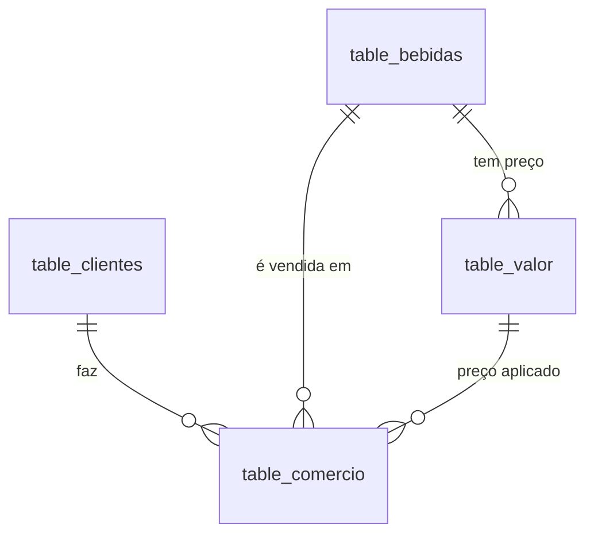

# Sistema Express — Modelagem Física em PostgreSQL

Sistema de uma distribuidora de bebidas. Este repositório é a **modelagem física** do modelo lógico da Sprint 3 (`Sistema_Express.sql`): DDL com restrições e tipos nativos do PostgreSQL, estratégia de indexação, transações ACID, análise com `EXPLAIN ANALYZE` e controle de acesso por privilégio mínimo.

Testado no **PostgreSQL 17.11** (os scripts usam apenas recursos do PostgreSQL 14+).

## Como executar

**Tudo de uma vez** (recria o banco `sistema_express`, roda os 7 scripts em ordem e grava a saída de cada um em [`docs/saidas/`](docs/saidas)):

```bash
./executar_tudo.sh          # precisa de um usuário que crie bancos e roles (ex.: postgres)
```

**Ou passo a passo com `psql`:**

```bash
createdb sistema_express
for f in 01_ddl 02_indices 03_carga_dados 04_transacoes 05_explain_analyze 06_controle_acesso 07_testes_acesso; do
  psql -d sistema_express -a -f sql/$f.sql
done
```

> Os arquivos `04` e `07` contêm **erros propositais** (`ERROR: ...` na saída) que demonstram `SAVEPOINT` e permissões negadas — não use `ON_ERROR_STOP` neles.
> As transações 1–3 usam `\gset` (recurso do **psql**) para guardar o ID devolvido pelo `RETURNING`. A transação 4 é SQL puro e roda também em DBeaver/pgAdmin.

| Arquivo | Conteúdo |
|---|---|
| [`sql/01_ddl.sql`](sql/01_ddl.sql) | Schema, tabelas, PK/FK, `NOT NULL`, `UNIQUE`, `CHECK`, `DEFAULT` |
| [`sql/02_indices.sql`](sql/02_indices.sql) | Índices, cada um com sua justificativa |
| [`sql/03_carga_dados.sql`](sql/03_carga_dados.sql) | Massa de teste: 400 bebidas, 20 mil clientes, 300 mil pedidos |
| [`sql/04_transacoes.sql`](sql/04_transacoes.sql) | 4 transações (`BEGIN/COMMIT/ROLLBACK/SAVEPOINT/RETURNING`) |
| [`sql/05_explain_analyze.sql`](sql/05_explain_analyze.sql) | 5 consultas analisadas com e sem índice + 1 contra-exemplo |
| [`sql/06_controle_acesso.sql`](sql/06_controle_acesso.sql) | Roles, usuários, `GRANT` / `REVOKE` |
| [`sql/07_testes_acesso.sql`](sql/07_testes_acesso.sql) | Prova prática do que cada usuário pode e não pode fazer |
| [`docs/saidas/`](docs/saidas) | Saída real (com `psql -a`) da execução de cada script |

---

## 1. Modelo



Todas as tabelas ficam no schema `express` (não no `public`), o que facilita conceder/retirar acesso ao sistema inteiro de uma vez.

| Tabela | Papel |
|---|---|
| `table_bebidas` | Catálogo e estoque |
| `table_clientes` | Clientes PF/PJ |
| `table_valor` | Histórico de preços: uma linha por vigência (`data_vigencia_fim IS NULL` = preço atual) |
| `table_comercio` | Pedidos: cliente × bebida × preço aplicado |

## 2. Escolha dos tipos de dados e restrições

Mudanças em relação ao modelo lógico e por quê:

| Decisão | Justificativa |
|---|---|
| `SERIAL` nas PKs | Inteiro de 4 bytes com sequence automática; suficiente (2,1 bi de linhas) e barato em índices e FKs. |
| `NUMERIC(10,2)` / `NUMERIC(12,2)` para dinheiro | Aritmética **exata**. `REAL`/`DOUBLE` acumulam erro de arredondamento (0,1 + 0,2 ≠ 0,3) — inaceitável em valor de venda. (`DECIMAL` do modelo lógico é sinônimo.) |
| `TIMESTAMPTZ` em vez de `TIMESTAMP` | Guarda o instante absoluto (UTC) e converte para o fuso da sessão. Pedidos de clientes em fusos diferentes ou mudança de horário de verão não geram datas ambíguas. |
| `DATE` em `data_vigencia_*` | Vigência de preço é por dia; não precisa de hora. |
| `TEXT` em vez de `VARCHAR(n)` | No PostgreSQL não há diferença de desempenho; o limite fica em `CHECK (char_length(...) <= n)`, mais fácil de evoluir que alterar o tipo da coluna. |
| `CHAR(2)` em `estado`, `CHAR(8)` em `cep` | Tamanhos realmente fixos (UF e CEP só com dígitos). |
| `cpf_cnpj` só com **dígitos** + `CHECK` de tamanho ligado ao `tipo_pessoa` (11 = CPF, 14 = CNPJ) | Sem máscara, o `UNIQUE` funciona de verdade (`123.456.789-00` ≠ `12345678900` seria um duplicado passando). A máscara é da tela, não do banco. |
| `CHECK (tipo_pessoa IN (...))`, `status_entrega`, `forma_pagamento` em vez de `ENUM` | Com `CHECK`, incluir um novo status é um `ALTER` simples; remover valor de `ENUM` não é possível. |
| `BOOLEAN` em `ativo`, `abastecido_mes` | Tipo nativo, 1 byte. |

Restrições de integridade além das PK/FK:

- `estoque_atual >= 0` — o banco **impede** vender mais do que existe, mesmo com dois vendedores concorrendo (usado na Transação 1).
- `quantidade > 0`, `preco_venda > 0`, `preco_custo >= 0`, `valor_total >= 0`.
- `data_vigencia_fim >= data_vigencia_inicio` e `data_entrega >= data_pedido`.
- `status_entrega = 'Entregue'` **se e somente se** `data_entrega` está preenchida.
- `UNIQUE (cpf_cnpj)`; `UNIQUE (id_bebida, data_vigencia_inicio)` — sem duas vigências começando no mesmo dia.
- **FK composta** `table_comercio (id_valor, id_bebida) → table_valor (id_valor, id_bebida)`: no modelo lógico, `id_bebida` e `id_valor` eram FKs independentes, então era possível registrar um pedido da bebida A com o preço da bebida B. A FK composta garante que o preço pertence à bebida do pedido.
- Regras de `ON DELETE`: `RESTRICT` de clientes/bebidas/preços usados em pedidos (histórico de vendas não some); `CASCADE` apenas de `table_bebidas → table_valor`.

## 3. Estratégia de indexação

O PostgreSQL já cria índices para toda `PRIMARY KEY` e `UNIQUE`. Só foram acrescentados índices para consultas **reais** do sistema. Cada índice extra encarece `INSERT/UPDATE/DELETE`, por isso a tabela que mais cresce (`table_comercio`) recebeu índices selecionados, com tipos diferentes conforme o padrão de acesso.

| Índice | Tipo | Consulta que atende | Por que assim |
|---|---|---|---|
| `idx_comercio_cliente_data (id_cliente, data_pedido DESC)` | B-tree composto | Últimos pedidos de um cliente; JOIN cliente↔pedido; `ON DELETE RESTRICT` da FK | Cobre a FK **e** o `ORDER BY`: o índice entrega as linhas já ordenadas, sem `Sort`. |
| `idx_comercio_bebida (id_bebida)` | B-tree | Vendas por bebida; `ON DELETE RESTRICT` da FK | FK usada em relatórios. |
| `idx_comercio_em_aberto (data_pedido) WHERE status_entrega IN ('Pendente','Em rota')` | **Parcial** | Fila de entregas em aberto (roteirização) | Só ~1% dos pedidos está em aberto. O índice tem **72 kB** (o total seria dezenas de MB) e pedidos já Entregues/Cancelados não pagam custo de escrita nele. |
| `idx_comercio_data_brin (data_pedido)` | **BRIN** | Relatórios por período | Pedidos entram em ordem cronológica, então a data tem correlação quase perfeita com a posição física. O BRIN tem **24 kB** contra ~11 MB de um B-tree equivalente e quase não pesa no `INSERT`. |
| `idx_clientes_cidade_bairro (cidade, bairro) WHERE ativo` | Parcial composto | Clientes ativos de uma região | Roteirização/prospecção; inativos ficam fora do índice. |
| `uq_valor_vigente (id_bebida) WHERE data_vigencia_fim IS NULL AND ativo` | **UNIQUE parcial** | "Qual o preço atual da bebida X?" | Além de acelerar essa consulta (a mais comum do sistema), **garante por constraint** que cada bebida tem no máximo um preço vigente. Ocupa 1 entrada por bebida. |

Índices que **não** foram criados, de propósito:

- **`table_bebidas (categoria, ...)`** — o catálogo tem centenas de linhas (~6 páginas). Um `Seq Scan` custa menos do que ir ao índice, e o índice só pesaria nas baixas de estoque (`UPDATE`). Confirmado na consulta Q6 abaixo.
- **`table_comercio (status_entrega)`** isolado — só 4 valores distintos (baixa seletividade); o índice parcial cobre o único caso útil.
- **`table_comercio (id_valor, id_bebida)`** — a FK composta não participa de JOINs frequentes e `table_valor` raramente sofre `DELETE`/alteração de chave.

## 4. Transações

Todas em [`sql/04_transacoes.sql`](sql/04_transacoes.sql). O `RETURNING` devolve o ID gerado pelo `SERIAL` e, com `\gset`, esse ID vira uma variável (`:id_cliente_t1`) usada nos `INSERT`s das tabelas filhas dentro da mesma transação.

| # | Cenário | Tabelas | Recursos |
|---|---|---|---|
| **1** | Novo cliente + primeiro pedido + baixa de estoque | `table_clientes`, `table_comercio`, `table_bebidas` | `BEGIN`, `SAVEPOINT`, `ROLLBACK TO SAVEPOINT`, `RELEASE`, `COMMIT`, `RETURNING` |
| **2** | Lançamento de produto novo (bebida + preço + pedido) | `table_bebidas`, `table_valor`, `table_comercio` | Cadeia de `RETURNING` (`id_bebida → id_valor → id_pedido`), `SAVEPOINT`, `COMMIT` |
| **3** | Reajuste de +8% nas cervejas, reprovado na conferência | `table_valor` | CTE `UPDATE … RETURNING` alimentando `INSERT`, `ROLLBACK` total |
| **4** | Variante 100% SQL (sem `\gset`) de cliente + pedido + estoque | 3 tabelas | CTEs encadeadas com `RETURNING`; roda em qualquer cliente |

**Transação 1** — o vendedor digita uma quantidade maior que o estoque. O `UPDATE` da baixa viola `ck_bebidas_estoque`; o `ROLLBACK TO SAVEPOINT sp_pedido` desfaz **só o pedido**, o cadastro do cliente permanece, e o pedido é refeito com 12 unidades. No `COMMIT`, cliente e pedido são gravados e o estoque cai exatamente 12 (65 → 53 na execução de exemplo):

```
psql: ERROR:  new row for relation "table_bebidas" violates check constraint "ck_bebidas_estoque"
 id_cliente |      nome      | id_pedido | quantidade | valor_total | estoque_antes | estoque_depois
      20001 | Bar do Ze Ltda |    300002 |         12 |      137.40 |            65 |             53
```

**Transação 2** — o pedido é lançado por engano com o `id_valor` de outra bebida. A FK composta rejeita (`Key (id_valor, id_bebida)=(1, 401) is not present in table "table_valor"`); o savepoint desfaz o pedido, mantendo bebida e preço já inseridos, e o pedido correto é gravado.

**Transação 3** — atomicidade em lote: dentro da transação existem 67 novas vigências de preço; após o `ROLLBACK`, a contagem volta a 0 e os preços antigos continuam vigentes.

**Observação sobre sequences:** `SERIAL` não é revertido pelo `ROLLBACK`. Por isso os IDs de pedido da saída pulam (300001 e 300003 foram consumidos em tentativas desfeitas). Isso é esperado e vale para qualquer sequence do PostgreSQL — IDs são únicos, não necessariamente contínuos.

**Concorrência (MVCC):** o nível padrão é `READ COMMITTED`. Leituras nunca bloqueiam escritas e vice-versa. A baixa `estoque_atual = estoque_atual - N` é atômica e, junto do `CHECK`, evita venda acima do estoque mesmo com vendedores simultâneos: o segundo espera o primeiro terminar e reavalia a linha.

## 5. Análise com `EXPLAIN ANALYZE`

Script: [`sql/05_explain_analyze.sql`](sql/05_explain_analyze.sql) · saída completa: [`docs/saidas/05_explain_analyze.txt`](docs/saidas/05_explain_analyze.txt).

Sem volume o planejador sempre escolheria `Seq Scan`, então a base foi carregada com 300 mil pedidos + `VACUUM ANALYZE`. Para cada consulta, o plano é medido **com** o índice e **sem** ele; o "sem" é feito com `BEGIN; DROP INDEX …; EXPLAIN ANALYZE …; ROLLBACK;` (DDL é transacional no PostgreSQL, então o índice volta intacto).

| Consulta | Índice | Plano com índice | Plano sem índice | Tempo com → sem | Páginas lidas com → sem |
|---|---|---|---|---|---|
| **Q1** últimos 10 pedidos de um cliente (+ JOIN bebida) | `idx_comercio_cliente_data` | `Index Scan` (sem `Sort`) | `Parallel Seq Scan` + `Sort` + `Gather Merge` | **0,04 ms → 9,6 ms** | 33 → 3.367 |
| **Q2** entregas em aberto ordenadas por data | `idx_comercio_em_aberto` | `Index Scan` (parcial, sem `Sort`) | `Parallel Seq Scan` + `Sort` | **0,45 ms → 14,0 ms** | 37 → 3.401 |
| **Q3** faturamento por dia, últimos 7 dias | `idx_comercio_data_brin` | `Bitmap Index Scan` (BRIN) + `Bitmap Heap Scan` | `Parallel Seq Scan` | **3,4 ms → 17,9 ms** | 132 → 3.401 |
| **Q4** clientes ativos de um bairro | `idx_clientes_cidade_bairro` | `Bitmap Index Scan` | `Seq Scan` | **0,11 ms → 1,9 ms** | 97 → 448 |
| **Q5** total vendido da bebida 42 | `idx_comercio_bebida` | `Bitmap Index Scan` | `Parallel Seq Scan` | **0,76 ms → 9,1 ms** | 677 → 3.327 |
| **Q6** bebidas de uma categoria com estoque baixo | *(nenhum, de propósito)* | — | `Seq Scan` em 6 páginas | 0,03 ms | 6 |

(Tempos da execução em `docs/saidas/`; variam de máquina para máquina, a proporção não.)

**Leitura dos planos:**

- **Q1** — o trecho decisivo é `Index Scan using idx_comercio_cliente_data … Index Cond: (id_cliente = 4321)`: o `LIMIT 10` para após ler 10 entradas do índice. Sem o índice o banco varre as 300 mil linhas (`Rows Removed by Filter: ~100.000` por worker) e depois ordena. A tabela `table_bebidas` do JOIN é acessada pela PK (`table_bebidas_pkey`), também via índice.
- **Q2** — o índice parcial atende o `WHERE` **e** o `ORDER BY`. Ele só contém ~2,4 mil das 300 mil linhas.
- **Q3** — o BRIN é *lossy*: `Heap Blocks: lossy=127` e `Rows Removed by Index Recheck` mostram que ele aponta faixas de páginas que podem conter as linhas e o banco reconfere cada linha. Mesmo assim lê 127 páginas em vez de 3.327. É o trade-off do BRIN: precisão menor, custo de armazenamento e escrita quase zero.
- **Q4/Q5** — `Bitmap Index Scan → Bitmap Heap Scan` é o plano típico para seletividade média (dezenas a centenas de linhas espalhadas): o índice monta um mapa das páginas e o banco lê cada página uma única vez. Na Q5 as 767 linhas estão espalhadas em 675 páginas; ainda assim é ~12× mais rápido que varrer a tabela.
- **Q6** — contra-exemplo: com 400 linhas o `Seq Scan` é o melhor plano. É por isso que `table_bebidas` não tem índice em `categoria`.

## 6. Controle de acesso

Script: [`sql/06_controle_acesso.sql`](sql/06_controle_acesso.sql) · testes: [`sql/07_testes_acesso.sql`](sql/07_testes_acesso.sql).

**Estrutura:** as permissões ficam em **roles de grupo** (`NOLOGIN`) e os usuários apenas pertencem a elas. Trocar a permissão de uma equipe é mexer em um lugar só.

| Objeto | Tipo | Perfil |
|---|---|---|
| `role_leitura` | ROLE (grupo) | Relatórios/análise |
| `role_operacao` | ROLE (grupo) | Rotina de balcão e entrega |
| `usr_analista` | USER (`LOGIN`), membro de `role_leitura` | `statement_timeout = 30s`, máx. 5 conexões |
| `usr_vendedor` | USER (`LOGIN`), membro de `role_operacao` | máx. 20 conexões |

**Matriz de permissões:**

| | `usr_analista` (leitura) | `usr_vendedor` (operação) |
|---|---|---|
| `table_bebidas` | `SELECT` | `SELECT` + `UPDATE (estoque_atual)` |
| `table_valor` (preços) | `SELECT` | `SELECT` (**não altera preço**) |
| `table_comercio` | `SELECT` | `SELECT`, `INSERT`, `UPDATE (status_entrega, data_entrega, forma_pagamento)` — não altera quantidade/valor de pedido já lançado |
| `table_clientes` | `SELECT` só das colunas **não sensíveis** (sem `cpf_cnpj`, `telefone`, `email`, endereço, CEP) | `SELECT`, `INSERT`, `UPDATE` de dados cadastrais — **exceto** `cpf_cnpj` e `tipo_pessoa` |
| `DELETE` / `TRUNCATE` | ✗ | ✗ (`REVOKE` explícito) |
| DDL (criar/alterar tabelas) | ✗ | ✗ |
| Sequences | — | `USAGE` só nas de clientes e pedidos (necessário para o `INSERT` com `SERIAL`) |

**Comandos usados:** `CREATE ROLE`, `GRANT … TO`, `GRANT SELECT (colunas)` / `GRANT UPDATE (colunas)` (privilégio por coluna, ligado à proteção de dados pessoais/LGPD), `REVOKE … FROM PUBLIC` (fecha `CONNECT` no banco, `CREATE` no schema `public` e todo acesso ao schema `express`), `REVOKE DELETE, TRUNCATE … FROM role_operacao`.

**Padrão negado:** nada é concedido a `PUBLIC` e não há `ALTER DEFAULT PRIVILEGES`; toda tabela nova precisa de um `GRANT` explícito, evitando que dados novos (ex.: uma futura tabela de cartões) fiquem visíveis por acidente.

**Prova prática** (`07_testes_acesso.sql`, saída em `docs/saidas/07_testes_acesso.txt`):

```
usr_analista  SELECT cidade, sum(valor_total) ...   -> OK
usr_analista  SELECT cpf_cnpj FROM table_clientes   -> ERROR: permission denied for table table_clientes
usr_analista  SELECT * FROM table_clientes          -> ERROR: permission denied  (inclui colunas sensíveis)
usr_vendedor  INSERT cliente + pedido + baixa       -> OK
usr_vendedor  UPDATE table_valor SET preco_venda    -> ERROR: permission denied for table table_valor
usr_vendedor  UPDATE table_clientes SET cpf_cnpj    -> ERROR: permission denied
usr_vendedor  DELETE FROM table_comercio            -> ERROR: permission denied
usr_vendedor  CREATE TABLE ...                      -> ERROR: permission denied for schema express
```

O teste também exercita `REVOKE`/`GRANT` ao vivo: retira `UPDATE (estoque_atual)` de `role_operacao` (a baixa passa a falhar), devolve a permissão (volta a funcionar) e remove `usr_vendedor` da role (perde acesso ao schema inteiro).

> ⚠️ As senhas em `06_controle_acesso.sql` (`*_troque_123`) são de **exemplo para estudo**. Em qualquer ambiente real, defina senhas próprias fora do repositório e configure `pg_hba.conf` com `scram-sha-256`.

## 7. Limitações conhecidas

- O modelo lógico da Sprint 3 tem **uma bebida por pedido** (`table_comercio`). Um pedido com vários itens exigiria separar `pedido` e `item_pedido`; foi mantido o modelo original.
- `valor_total = quantidade × preco_venda` é calculado pela transação; o `CHECK` não consegue validar isso porque depende de outra tabela (só um *trigger* faria).
- Não há proteção contra vigências de preço **sobrepostas** já encerradas (só contra duas em aberto e duas com o mesmo início). Uma `EXCLUDE USING gist` com `daterange` (extensão `btree_gist`) resolveria.
- A massa de dados é sintética: CPFs/CNPJs seguem só o formato (11/14 dígitos), sem dígito verificador.
